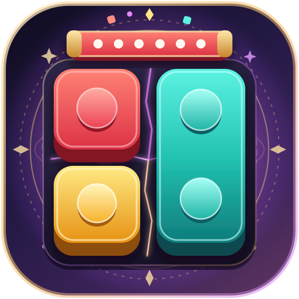

<p align="center">
  
</p>

<h1 align="center">ShredBlocks: Color Jam</h1>

<p align="center">
  <strong>A tactile 3D block-sliding puzzle game set in a mystic architectural sanctuary.</strong><br />
  100% Free · Zero Ads · Zero IAP · Works Offline on Mobile & Desktop
</p>

<p align="center">
  <a href="https://shredblocks.skorupski.org"><strong>▶ Play in Browser</strong></a> ·
  <a href="#features"><strong>Features</strong></a> ·
  <a href="#quick-start"><strong>Quick Start</strong></a> ·
  <a href="#architecture--tech-stack"><strong>Architecture</strong></a> ·
  <a href="LICENSE"><strong>MIT License</strong></a>
</p>

---

## Overview

**ShredBlocks: Color Jam** is a 3D spatial polyomino puzzle game built for the web in zero-dependency TypeScript and WebGL2. Slide colorful 3D blocks across sculpted stone courtyards into matching perimeter shredder gates, where rotating teeth slice them into bursts of 3D particles.

## Features

- **300 Campaign Levels + Canonical Infinite Endless Mode**: Progress across 6 architectural chapters—from approachable `5×5` courtyards to non-rectangular atriums, multi-room portcullis sanctums, sealed mystery vaults, and `9×9` citadels—followed by deterministically seeded Endless Mastery boards (`Level 301+`, identical for every player on every device) with 50-stage Sanctuary Map tier filters and inline archive browsing. Every stage is verified 100% solvable without power-ups by a deterministic A\* solver.
- **Three Independent Play Modes & At-a-Glance Sanctuary Keystone HUD (`MAP-MODE-SPLIT-01`, `MODE-ISOLATION-01`, `HUD-KEYSTONE-01`)**:
  - **Challenge**: Clear the courtyard within a calibrated move budget shown prominently on the Sanctuary Keystone plaque alongside live star-cutoff progress (`1–3★`), first-clear Flow Streak bonuses, and chest rewards on its own campaign ladder.
  - **Zen**: Untimed, unlimited-move sanctuary flow in the exact same Keystone silhouette with a serene zero-pressure (`∞ No Limit`, `🌿 Calm Flow` / `🌿 Bombs Inert`) readout and up to 3 consecutive breather skips—every 3 unique Zen clears awards `+1` Gold Star, and every 4 unique clears banks a **🌿 Zen Blessing** (up to 3) for a free `+5 Moves` / `+20s` Continue in Challenge or Speed Rush.
  - **Speed Rush**: An arcade countdown ladder for speedrunners surfacing a high-legibility `MM:SS` clock, live star cutoffs, move-paced bomb fuses, and near-zero amber/crimson peripheral urgency (`<= 15s` / `<= 5s`). Switching modes live cleanly from the Keystone or Sanctuary Map always starts a Move-0 attempt while keeping each mode's frontier independent, and global Power-Up unlocks (`L2/8/18/30`) plus 10-stage Level Chests advance through genuine clears across any mode.
- **18 Gradual Mechanics & Guided Onboarding**: Introduces new spatial twists step by step with scannable onboarding hint plaques—including axis-locked rails, stepped-edge gates, multi-room portcullis sanctums, sealed mystery vaults, multi-layer blocks, ice blocks & frozen gates, star gates, keys & locks, neutral stone sliders, wooden crates, time-bombs, glued block groups, ropes & scissors, dynamic shutters, sliding/resizing gates, block generators, colored floor paths, and moving elevators.
- **Power-Ups, Quick-Swap Cosmetics & Live 3D Themes Studio**: Earn coins through normal play and milestone chests to stock 5 optional boosters (*Undo*, *Hint*, *Hammer*, *Row/Col Rocket*, *Color Vacuum*) and unlock 15 cosmetic **Block Skins**, **Board Trays**, and **Shred Animations** (*Micro Cubes*, *Star Confetti*, *Pixel Sparks*, buoyant *Soap Bubbles*, and *Lightning Bolts* with 120Hz volumetric plasma gate arcs), each paired with its own custom procedural Web Audio shred soundscape. Swap owned themes in 1 tap from the **Settings** Cosmetics drawer or test-drive any locked combination before buying on the pinned **Live 3D Showcase Stage** in Themes Studio—without losing mid-level progress when returning to the same stage.
- **Player-Friendly & Accessible**: Unlimited lives, 3 free undos per attempt, free Zen skips & Zen Blessing rescues, colorblind symbol badges, high-contrast palettes, full keyboard navigation, and reduced-motion mode.
- **Offline PWA & Account-Free Sync**: Installs to iOS, Android, or Desktop home screens and runs offline after the first visit. Transfer progress across devices without an account using a compact Save Code, shareable Sync Link, offline QR Code, or JSON backup.

## Controls

| Input | Action |
| :--- | :--- |
| **Touch / Mouse** | Drag any movable block along open lanes; pull into a matching perimeter gate to shred, or tap locked blocks, obstacles, and colored floor paths to inspect their rules. |
| **Keyboard** | `Tab` / `Shift+Tab` to cycle blocks · `Arrow Keys` or `WASD` to slide · `Escape` to cancel or close dialogs. |
| **Sanctuary Map & Stage Rules** | Tap the in-game **Level Title / Difficulty Crest** (or `‹ Map`) to jump back to that stage; tap the Keystone metrics plaque anytime to inspect exact `1–3★` cutoffs and mode rules. |
| **Accessibility** | Toggle **Colorblind Symbols**, **High Contrast**, and **Low Motion** anytime in **Settings**. |

---

## Quick Start

Requires **Node.js `>= 20`** and **npm `>= 10`**.

```bash
# Install dependencies
npm install

# Start local dev server (http://127.0.0.1:4173)
npm run dev

# Build production static bundle into dist/
npm run build
```

<details>
<summary><strong>Developer & Test Scripts</strong></summary>

```bash
# Start HTTPS LAN server for phone/tablet testing over Wi-Fi (https://<LAN-IP>:8443/)
npm run dev:lan

# Lint & format check (Biome)
npm run lint

# Run unit, economy & 300-level A* solver tests (Vitest)
npm run test:unit

# Fast preflight: Biome lint + unit tests + TypeScript & Vite production build
npm run verify:fast

# Capture & audit specific UI scenes across multi-viewport presets
npm run probe:ui -- --scene pause-expanded --viewports quick

# Run Desktop & Mobile browser playtests (Playwright)
npm run test:e2e

# Run deterministic visual regression snapshots
npm run test:visual

# Regenerate app icons, multi-size favicon.ico & 1200x630 social preview image
./node_modules/.bin/tsx scripts/generate-icons.ts
```
</details>

---

## Architecture & Tech Stack

The entire game—3D WebGL2 renderer, swept grid physics, A\* puzzle solver, procedural Web Audio synthesizer, binary save codec, and QR code generator—is written in strict TypeScript with **zero runtime npm dependencies**.

| Subsystem | Highlights | Key Paths |
| :--- | :--- | :--- |
| **3D Renderer & Shaders** | 4-pass WebGL2 pipeline, procedural 3D polyomino & courtyard meshes, custom GLSL skin/tray shaders, GPU-instanced 3D particles, adaptive `60Hz`/`120Hz` quality scaling, and `Canvas2D` fallback | [`src/render/`](src/render/) |
| **Physics & Puzzle Engine** | Continuous swept grid raycast with corner bevel assist, gate aperture & mid-drag capture rules, multi-room/vault gating, and deterministic clear cascades | [`src/core/`](src/core/), [`src/input/`](src/input/) |
| **Campaign, Generator & Solver** | 300 campaign stages (curated showcases + canonical `Mulberry32` procedural ramp), Infinite Endless generator (`Level 301+`), and Zobrist A\* macro-move solver & hint engine | [`src/levels/`](src/levels/) |
| **UI, Audio & Offline Storage** | Self-hosted `Fraunces` & `Plus Jakarta Sans` variable `.woff2` fonts, mode-attuned procedural Web Audio lo-fi chill soundtrack (`AMBIENT-MUSIC-01`) + custom shred SFX, dual-layer `localStorage` + `IndexedDB` saves, compressed `SB1-...` codec + ISO 18004 QR SVG, and offline Service Worker | [`src/ui/`](src/ui/), [`src/audio/`](src/audio/), [`src/storage/`](src/storage/), [`public/sw.js`](public/sw.js) |

For contributor workflows and deep-dive subsystem specifications, see [`AGENTS.md`](AGENTS.md) and [`docs/ARCHITECTURE_AND_RULES.md`](docs/ARCHITECTURE_AND_RULES.md).

---

## Deployment

`npm run build` produces a self-contained static site in `dist/` with no backend requirements, ready for any static host (Cloudflare Pages/Workers, GitHub Pages, Netlify, Vercel, S3/CloudFront, or Nginx).

<details>
<summary><strong>Cloudflare Pages / Fork Configuration Notes</strong></summary>

[`wrangler.jsonc`](wrangler.jsonc) and [`public/_headers`](public/_headers) configure security and cache headers for the live deployment at `https://shredblocks.skorupski.org`. If deploying a fork to your own domain, update the canonical URL in [`index.html`](index.html), [`public/robots.txt`](public/robots.txt), [`public/sitemap.xml`](public/sitemap.xml), and [`src/storage/save-manager.ts`](src/storage/save-manager.ts) (and remove `wrangler.jsonc` if using another host).

By default, source and fork builds include **zero external analytics** and lock Content Security Policy strictly to `'self'`. To enable optional, offline-safe aggregate visit tracking on your own deployment, set `VITE_GA_MEASUREMENT_ID=G-XXXXXXXXXX` (and/or `VITE_CF_WEB_ANALYTICS=true` or `VITE_CF_BEACON_TOKEN=<32-hex-token>`) in your CI/host build environment variables—[`vite.config.ts`](vite.config.ts) automatically stamps the matching HTTPS origins into CSP at build time without permitting `'unsafe-inline'`, and [`src/ui/telemetry-analytics.ts`](src/ui/telemetry-analytics.ts) loads them during low-priority post-boot idle only when online.
</details>

---

## Privacy & License

- **Analytics & Zero Monetization**: ShredBlocks has zero ads, zero in-app purchases, and zero monetization. The hosted deployment at `shredblocks.skorupski.org` uses Cloudflare Web Analytics and Google Analytics (with Google Signals and ad personalization disabled) for basic page-visit and general usage metrics, loaded asynchronously so offline play and content blockers are never affected. Self-hosted and fork builds ship with analytics disabled by default unless opted in at build time.
- **Local Save Ownership**: Player progress and save data stay 100% local on your device and can be exported or backed up anytime without an account.
- **License**: [MIT License](LICENSE).
