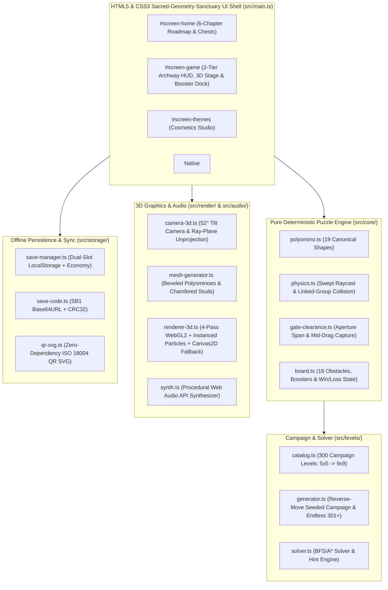

# ShredBlocks: Color Jam

> **100% Free-to-Play · Zero Ads · Zero IAP · Offline-First 3D Polyomino Color-Sort & Shredder Puzzle PWA**
>
> **Live Deployment:** [https://shredblocks.skorupski.org](https://shredblocks.skorupski.org) · **Source Repository:** [https://github.com/jskorupski/Shred-Blocks](https://github.com/jskorupski/Shred-Blocks) · **License:** [MIT](LICENSE)

**ShredBlocks: Color Jam** is a zero-dependency, offline-first 3D WebGL2 spatial puzzle game set in a serene sacred-geometry architectural sanctuary. Slide tactile 3D polyomino blocks across a floating twilight courtyard into matching perimeter shredder gates, watch rotating teeth slice blocks into GPU-instanced 3D particles, and master **18 distinct puzzle mechanics** across **300 solver-verified campaign levels (`5×5` $\rightarrow$ `9×9`)** plus **Infinite Seeded Procedural Endless Mastery (`Level 301+`)**.

---

## ✨ Key Highlights

- **Sacred-Geometry Architectural 3D Diorama & Tactile UI**:
  - Custom zero-dependency **WebGL2 3D Engine** (with automatic `Canvas2D` fallback and instant `webglcontextlost` / `webglcontextrestored` recovery) featuring stepped architectural sanctuary plinths, warm sunlit key lighting paired with cool twilight lavender shadows, chamfered 3D circular block studs, and a GPU-instanced 3D particle shredder system (`gl.drawArraysInstanced`, up to 2,048 active particles).
  - **Sculpted 3D Side-Flange Axis-Lock Rails & Medallions (`↔` / `↕`)**: Axis-locked blocks integrate 3D beveled side-flange guide rails (`railBeamMesh` tinted with block-harmonized `lipHex` and warm champagne metallic caps) that leave the circular 3D top studs 100% uncovered, paired with sculpted 3D circular/octagonal metallic medallions (`drawBadgeMedallion3D`).
  - **Early-Stage Hollow 3D Beveled Move Guide**: Onboarding levels (`Levels 1–5`, `Level 11` Axis-Lock debut, and `4.0s` idle prompts on `Levels 1–30` & mechanic showcase levels) animate a hollow 3D beveled perimeter frame and stepping floor chevrons from the optimal block to its target gate without obscuring the underlying block.
  - **Dynamic Grabbed Block Focus & Knock-On Shockwave Juice**: Grabbed blocks elevate (`+0.46Z`), expand (`1.05x` around their centroid), cast an offset floor drop shadow, and glow with a golden-white selection halo while non-grabbed blocks subtly dim (`0.88x`). Every shred, layer peel, ice thaw, key/lock release, rope cut, crate shatter, shutter/gate shift, generator spawn, and elevator shift triggers isolated expanding 3D shockwave rings, scale-bounce pops, and directional particle bursts on the exact gate and blocks involved.
  - **Celebratory 3-Voice Victory Fanfare & 3D Courtyard Fireworks**: Clearing a level triggers an upbeat 3-voice Web Audio composition (`Fmaj9 -> G13 -> Cmaj9` chords, syncopated marimba/bell melody, and star-pop crystalline chimes), a 3D courtyard confetti & shockwave fountain visible behind a translucent Victory modal backdrop, and a rotating Sacred Geometry Sunburst Victory Crest (`#victory-crest-ornament`).
  - **Sacred-Geometry Title Crest & Adaptive Player Flows (`#title-overlay`)**: Launches over the live 3D courtyard backdrop with a rotating celestial astrolabe crest. Brand-new players tap **`▶ BEGIN JOURNEY`** and enter **Level 1 (`First Shred`)** immediately without menu clutter, while returning players see their current Chapter badge, `Stars / Coins / Streak` progress plaque, **`▶ CONTINUE · LEVEL N`** hero CTA, and quick **`Sanctuary Map`** / **`Themes Studio`** navigation buttons.
  - **Cross-Platform PWA Launcher Icons**: Full-bleed W3C maskable icons (`icon-maskable.svg`, `icon-maskable-192.png`, `icon-maskable-512.png`), iOS/iPadOS `180×180` `apple-touch-icon.png`, and standalone squircle icons (`icon.svg`, `icon-192.png`, `icon-512.png`) tailored for Samsung One UI, Android Pixel, iOS Home Screen, and Desktop launchers.
  - Atmospheric twilight-to-terracotta `oklab` gradient skies, sacred-geometry accents, and tactile 3D beveled cards across Mobile (`360×640`, `390×844`), Tablet (`768×1024`), and Desktop (`1440×900`).
- **Dual Play Modes — Switch Anytime**:
  - **🧘 Zen Mode (Default)**: Untimed, meditative puzzle-solving. Take your time to find the optimal move sequence and earn **1–3 Stars** based on move efficiency relative to the level's solver-verified `parMoves`.
  - **⏱ Timed Rush Mode**: Opt-in arcade countdown clock where fast clears award **1–3 Speed Stars** (`>= 35%` time left = `⭐⭐⭐`, `>= 15%` = `⭐⭐`).
- **No-Paywall Fairness & Player Respect (`F-01`–`F-04`)**:
  - **Unlimited Lives**: Never wait on a heart timer.
  - **Free Level Skip**: Stuck on a tricky puzzle? Skip any level anytime for **0 Coins** (`⏭️ Skip`).
  - **3 Free Undos Per Level**: Every level attempt starts with 3 free single-step undos (including accidental restart recovery!), plus unlimited inventory/coin undos.
- **300 Solver-Verified Campaign Levels (`5×5` $\rightarrow$ `9×9`) + Endless Mode (`301+`)**:
  - Every campaign level (`1..300`) and procedural Endless level (`301+`) is verified at build and test time by the deterministic **State-Space BFS/A\* Puzzle Solver** ([`src/levels/solver.ts`](src/levels/solver.ts)), guaranteeing 100% solvability without boosters, enforcing the **First-Move Safety Invariant (`UX-03`)**, and pacing difficulty across **6 Progressive Courtyard Epochs** with **Fun-First Breather Levels (`RAMP-01`–`RAMP-05`)** every 5th stage.
- **Offline-First PWA & Cross-Device Save Sync**:
  - Works 100% offline after the first visit via a versioned Service Worker ([`public/sw.js`](public/sw.js)).
  - **4 Zero-Backend Backup & Transfer Channels**: Compact `SB1-...` Base64URL Save Code (with CRC32 integrity), Magic `#import=SB1-...` Sync Link, pure-TypeScript **Offline QR Code SVG** generator ([`src/storage/qr-svg.ts`](src/storage/qr-svg.ts)), and `.json` file export/import—complete with a side-by-side **Overwrite Diff Confirmation** and **1-Tap Pre-Import Backup Rollback**.

---

## 🧩 Complete 18-Obstacle Progression Roadmap

New mechanics are introduced gradually with non-blocking in-game tutorial banners and dedicated showcase levels:

| # | First Level | Obstacle / Mechanic | Gameplay Rule |
| :-: | :-: | :--- | :--- |
| **1** | **Lvl 1** | **Polyomino Blocks & Shredder Gates** | Slide `1×1`, `1×2`, `1×3`, `2×2`, `L`, `T`, `Z`, and `+` blocks into matching perimeter gates whose span fits the block's perpendicular profile (`F-02`). |
| **2** | **Lvl 11** | **Axis-Locked Blocks (`↔` / `↕`)** | Engraved directional rails restrict movement strictly to the Horizontal (`H`) or Vertical (`V`) axis. |
| **3** | **Lvl 21** | **Board Cutouts (`-1`)** | Non-rectangular courtyard footprints (`L`, `T`, `+`, and stepped corners) create tight choke points. |
| **4** | **Lvl 21** | **Interior Stone Pillars (`-2`)** | Immovable architectural stone columns embedded inside the grid that blocks must route around. |
| **5** | **Lvl 31** | **Multi-Layer Blocks** | Outer color shells peel away at a matching gate (`colorCursor++`), revealing an inner core block that remains on the board. |
| **6** | **Lvl 41** | **Frozen Ice Blocks (`❄️ N`)** | Encased in translucent ice; cannot move until `N` other blocks/layers are shredded (`iceCount` decrements by 1 per shred). |
| **7** | **Lvl 51** | **Star Blocks & Star Gates (`★`)** | Star-badged blocks can only shred through matching-color Star Gates (`gate.isStar === true`), while normal blocks can use any matching gate. |
| **8** | **Lvl 61** | **Key (`🔑`) & Chained Lock (`🔒`)** | Chained blocks are immobilized until the block carrying the matching `lockId` Key is shredded. |
| **9** | **Lvl 71** | **Movable Neutral Stone Sliders (`color: 0`)** | Heavy charcoal monolith blocks that never shred through any gate (`checkBlockGateClearance === false`) but slide freely to unblock lanes (`FR-26`). |
| **10** | **Lvl 81** | **Wooden Crates (`📦`)** | Destructible `1×1` crates (`hp: 1..3`) that crack and shatter whenever an adjacent block shreds at a gate. |
| **11** | **Lvl 91** | **Time-Bomb Blocks (`💣 N`)** | Tick down by `1` per committed move in Zen Mode (or `1` per second in Timed Rush); shred before reaching `0` to defuse! |
| **12** | **Lvl 101** | **Glued Linked Groups (`groupId`)** | Separate blocks bonded by golden solder bars move as a rigid multi-block assembly (`F-03`); when one member shreds, surviving partners remain on the board! |
| **13** | **Lvl 111** | **Colored Ropes (`🪢`) & Scissors (`✂️`)** | Blocks tied in colored rope untie automatically when a block carrying matching-color Scissors is shredded. |
| **14** | **Lvl 121** | **Color-Changing Gates** | Gates with a multi-color queue (`colorQueue: [c1, c2, ...]`) advance to their next queued color immediately after each shred. |
| **15** | **Lvl 131** | **Frozen Gates (`❄️ N`)** | Perimeter gates encased in ice that thaw by `1` whenever a block shreds through any other active gate. |
| **16** | **Lvl 141 / 145** | **Jewel-Locked & Toggling Shutter Gates** | Steel shutter bars either unlock when a matching Shutter Gem (`💎`) is shredded (`Lvl 141`) or toggle open/closed after every shred (`Lvl 145`). |
| **17** | **Lvl 151 / 155** | **Sliding & Size-Changing Gates** | Dynamic gates that shift along the wall (`slidesOnClear`) or expand/contract their aperture (`sizeChangesOnClear`) after each shred. |
| **18** | **Lvl 161 / 171 / 181** | **Generators, Floor Paths & Moving Elevators** | **Generators (`Lvl 161`)** spawn queued blocks onto `[spawnRow, spawnCol]`; **Colored Floor Paths (`Lvl 171`)** only allow matching-color blocks to cross; **Moving Elevators (`Lvl 181`)** shift contained blocks after each shred. |

---

## 🛠️ Progressive Power-Ups, Rarity Tiers & Themes Studio

### 5 Power-Ups with Gradual Unlocking & Rarity Tiers (`ECON-01`–`ECON-04`)
Power-ups are introduced gradually across the first 30 levels so early puzzles teach pure spatial mastery, and chest drops use a level-gated rarity-weighted loot table so high-impact power-ups feel genuinely special and rare—while **Free Level Skip (`0 Coins`)** remains available on every level so you are never locked out:

| Power-Up | Rarity Tier | Unlocks At | Starting Stock | Refill Price | Shredder Chest Drop Weight | Effect |
| :--- | :---: | :---: | :---: | :---: | :---: | :--- |
| **Undo** | `COMMON` | **Level 1** | `3 Free / Lvl` + `3` | `60 Coins` | **42%** | Reverts the last committed move—or restores your board if you accidentally tapped Restart! |
| **Hint / Time Freeze** | `UNCOMMON` | **Level 2** | `2` | `80 Coins` | **30%** | Highlights the solver's optimal next move (`source -> target`) in Zen Mode, or freezes timers and bombs for `+10s` in Timed Rush. |
| **Hammer** | `RARE` | **Level 8** | `1` | `140 Coins` | **16%** | Tap any colored block, Neutral Stone Slider, Wooden Crate, or Frozen/Locked Shutter Gate to smash or peel one layer. |
| **Row / Col Rocket** | `EPIC` | **Level 18** | `1` | `220 Coins` | **8%** | Toggle `↔ ROW` or `↕ COL` and tap any cell to blast one layer across the entire row or column. |
| **Color Vacuum** | `LEGENDARY` | **Level 30** | `1` | `350 Coins` | **4%** | Tap any unlocked colored block to sweep every unlocked block of that active color off the board at once. |

### Themes Studio (`15 Unlockable Cosmetics`)
Spend earned Coins (`150 Coins` each) in the **Themes Studio** to customize:
- **5 Block Skins**: *Classic Studs*, *Smooth Bevel*, *Gummy Jelly*, *Carved Wood*, *Neon Cyber*
- **5 Board Trays**: *Industrial Slate (Twilight Citadel)*, *Warm Birch*, *Midnight Arcade*, *Frosted Quartz*, *Mint Studio*
- **5 Shred Particle Styles**: *Micro Cubes*, *Star Confetti*, *Pixel Sparks*, *Soap Bubbles*, *Lightning Bolts*

---

## 🏗️ System Architecture & Tech Stack

### Zero-Runtime-Dependency Tech Stack

| Layer | Technology / Implementation | Key Source Files |
| :--- | :--- | :--- |
| **Language & Bundler** | TypeScript `5.7` (`strict: true`) + Vite `6` (0 runtime npm dependencies) | [`package.json`](package.json), [`tsconfig.json`](tsconfig.json), [`vite.config.ts`](vite.config.ts) |
| **3D Graphics & Shaders** | Custom 4-Pass WebGL2 Renderer, Procedural 3D Polyomino Mesh Builder, 1024×1024 Mipmapped Texture Atlas, GPU-Instanced Particle System (`2048` instances), `QualityGovernor` (`120Hz`/`60Hz`), `Canvas2D` Fallback | [`src/render/renderer-3d.ts`](src/render/renderer-3d.ts), [`src/render/mesh-generator.ts`](src/render/mesh-generator.ts), [`src/render/atlas-3d.ts`](src/render/atlas-3d.ts), [`src/render/camera-3d.ts`](src/render/camera-3d.ts) |
| **Physics & Puzzle Core** | Channel-Locked Orthogonal Swept Grid Raycast (`0.30`-cell corner bevel assist), Gate Aperture & Axis-Lock Clearance, Fixed-Point Clear Cascade | [`src/core/physics.ts`](src/core/physics.ts), [`src/core/gate-clearance.ts`](src/core/gate-clearance.ts), [`src/core/board.ts`](src/core/board.ts), [`src/core/polyomino.ts`](src/core/polyomino.ts) |
| **Campaign, Generator & Solver** | 300 Campaign Levels across 6 Courtyard Epochs (`5×5` $\rightarrow$ `9×9`), `Mulberry32` Reverse-Move Procedural Generator (`301+`), State-Space BFS/A\* Solver & Hint Engine | [`src/levels/catalog.ts`](src/levels/catalog.ts), [`src/levels/generator.ts`](src/levels/generator.ts), [`src/levels/solver.ts`](src/levels/solver.ts) |
| **Procedural Audio & Haptics** | Zero-Asset Web Audio API Polyphonic Synthesizer + Pentatonic Ambient Loop + Vibration API Wrapper | [`src/audio/synth.ts`](src/audio/synth.ts) |
| **Offline Sync & Storage** | Dual-Slot `localStorage` + `IndexedDB` Reconciliation, `SB1-<base64url>-<crc32>` LZ77 Save Codec, Pure-TS ISO/IEC 18004 QR Code SVG Generator, Offline Service Worker | [`src/storage/save-manager.ts`](src/storage/save-manager.ts), [`src/storage/save-code.ts`](src/storage/save-code.ts), [`src/storage/qr-svg.ts`](src/storage/qr-svg.ts), [`public/sw.js`](public/sw.js) |
| **Automated Verification** | Vitest Unit & 300-Level Solver Suite (`36` tests in `< 1.5s`), Playwright E2E Browser Suite (`10` specs), Multi-Viewport Visual Harness (`28` screenshots) | [`tests/unit/`](tests/unit), [`tests/e2e/shredblocks.spec.ts`](tests/e2e/shredblocks.spec.ts), [`scripts/visual-harness.ts`](scripts/visual-harness.ts) |



---

## 🎮 Controls & Accessibility

- **Touch / Mouse Drag**: Press and drag any movable 3D block smoothly along open grid lanes; pull a matching block into an aligned perimeter gate to shred it mid-drag!
- **Full Keyboard Navigation (`AX-03`)**:
  - `Tab` / `Shift+Tab`: Cycle focus across active movable blocks on the board.
  - `ArrowUp` / `W`, `ArrowDown` / `S`, `ArrowLeft` / `A`, `ArrowRight` / `D`: Slide the selected block 1 cell in that direction (or shred into an adjacent gate).
  - `Escape`: Cancel active booster targeting or close open settings modals.
- **Accessibility Suite (`AX-01`–`AX-04`)**:
  - **Colorblind Symbols (`AX-01`)**: Toggle high-contrast geometric symbols (`● ▲ ■ ◆ ★ ✚ ▼ ⬟`) rendered on every 3D block stud, gate indicator, and floor path.
  - **High-Contrast Palette**: Boosts luminance separation across all 8 block colors and tray tiles.
  - **Reduced Motion**: Honours `prefers-reduced-motion` and provides a manual toggle in Settings.

---

## 🚀 Local Development, Testing & Verification

### Prerequisites
- **Node.js** `>= 20.x` and **npm** `>= 10.x`

### Quick Start
```bash
# Install dependencies
npm install

# Start local development server (http://127.0.0.1:4173)
npm run dev

# Start LAN HTTPS preview server for testing on phones/tablets over Wi-Fi (https://<LAN-IP>:8443/)
# Auto-generates .certs/key.pem & .certs/cert.pem on first run
npm run dev:lan

# Type-check and build production bundle into dist/
npm run build
```

### Verification & QA Commands
```bash
# 1. Run Vitest unit & 300-level BFS solver verification suite (< 1.5s, 36 tests)
npm run test:unit

# 2. Run Playwright E2E interactive browser playtest suite (all 18 mechanics, drag-and-drop, boosters, offline SW)
npm run test:e2e

# 3. Capture 28 multi-viewport visual verification screenshots (360x640, 390x844, 768x1024, 1440x900)
npm run verify:visual
```

---

## ☁️ Deploying to Cloudflare (Workers Static Assets & Pages)

This project is pre-configured for zero-config deployment on **Cloudflare Workers & Pages** via [`wrangler.jsonc`](wrangler.jsonc) and [`public/_headers`](public/_headers):

1. In the **Cloudflare Dashboard**, navigate to **Workers & Pages** $\rightarrow$ **Create** $\rightarrow$ **Connect to Git** and select [`jskorupski/Shred-Blocks`](https://github.com/jskorupski/Shred-Blocks).
2. Configure the build settings:
   - **Production branch**: `main`
   - **Build command**: `npm run build`
   - **Deploy command (Workers Builds)**: `npx wrangler deploy` (reads [`wrangler.jsonc`](wrangler.jsonc) and serves `./dist` with SPA not-found handling) — or **Build output directory**: `dist` for classic Pages.
3. Attach your custom domain (`shredblocks.skorupski.org`) under **Custom domains / Routes**.

---

## 🔒 Privacy, Offline Guarantee & License

- **Zero Telemetry or Tracking**: No analytics scripts, no third-party cookies, and no external network requests.
- **100% Local & Portable Save State**: Your progress lives in your browser's `localStorage` (`shredblocks_save_v1` + automatic backup slot) and can be exported anytime as a compact `SB1-...` string, QR code, or JSON file.
- **License**: Released under the permissive [MIT License](LICENSE). You are free to use, study, modify, and distribute this code for any purpose.
