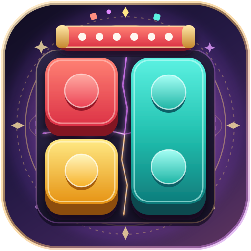
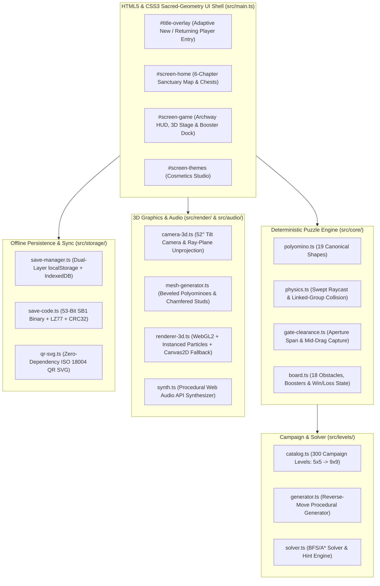

<p align="center">
  
</p>

<h1 align="center">ShredBlocks: Color Jam</h1>

<p align="center">
  <strong>A 3D spatial block-sliding puzzle game set in a sacred-geometry architectural sanctuary.</strong><br />
  100% Free-to-Play · Zero Ads · Zero IAP · Works Offline on Mobile & Desktop
</p>

<p align="center">
  <a href="https://shredblocks.skorupski.org"><strong>▶ Play in Browser</strong></a> ·
  <a href="#-quick-start-run-locally"><strong>Quick Start</strong></a> ·
  <a href="#-gameplay--features"><strong>Gameplay & Features</strong></a> ·
  <a href="#-architecture--tech-stack"><strong>Architecture</strong></a> ·
  <a href="LICENSE"><strong>MIT License</strong></a>
</p>

---

## 🎯 At a Glance

**ShredBlocks: Color Jam** is a tactile 3D polyomino puzzle game built for the web with zero runtime dependencies. Slide colorful 3D blocks across a floating twilight courtyard into matching perimeter shredder gates—and watch rotating teeth slice them into bursts of 3D particles.

- **🧩 300 Campaign Levels + Infinite Endless Mode**: Hand-tuned & constraint-generated progression from cozy `5×5` onboarding courtyards (`L1–12` First-Move Safe) to cross-corridor blocker puzzles (`L13+`), sculpted non-rectangular atriums, **Tall Portrait Sanctums (`8×6`, `9×7`, `10×8`)**, **Multi-Room Portcullis Sanctums**, **Sealed Mystery Vaults (`🔒 N`)**, and `9×9` Grand Citadels—backed by a deterministic A\* puzzle solver so every board is 100% solvable without boosters.
- **⚔️ Three Play Modes (1-Tap Switch Anytime)**:
  - **Tactical Challenge (Default)**: Solve within a calibrated **Move Budget (`parMoves + tierBuffer`)** with forgiving **Touch-Move Coalescing** (multi-drag adjustments of the same block count as `1` move) to earn **1–3 Gold Stars**, **Flow Streak bonuses**, and **25-Star Reliquary Chests**.
  - **Zen Mode**: Untimed, unlimited-move sanctuary play (**1 tap away** in HUD, Pause, or Out-of-Moves modal) that advances the campaign freely with a **`🌿 Zen`** badge (`0` Gold Stars; replay anytime in Challenge/Timed for Gold Stars!).
  - **Timed Rush**: Calibrated arcade countdown clock (`parMoves × secPerMove + 12s`) for speedrunners, awarding **1–3 Gold Stars**. Gold Star thresholds scale to each level's spare moves (or remaining time), and any paid Continue caps the clear at 1★.
- **💚 100% Fair & Player-Friendly**: Unlimited lives, **3 Free Undos** on every level attempt, **1-tap Zen Mode rescue**, and **Free Level Skip (`0 Coins`)** anytime you want to move past a stage.
- **📱 Offline-First PWA & Contextual Updates**: Installs directly to your iOS, Android, or Desktop home screen and runs 100% offline after the first visit, with zero-cutoff container-query viewport sizing (`VIEWPORT-01`) across browser & standalone modes and non-overlapping Sanctuary Update Ribbons on the Title & Map screens (`PWA-UPDATE-01`).
- **🔄 Zero-Account Cross-Device Sync & Infinite Progression**: Local progress is persisted across dual-layer `localStorage` + `IndexedDB` storage and transfers seamlessly between phone, tablet, and desktop—even across thousands of Infinite Endless stages—via a compact `SB1-...` Save Code, shareable Sync Link, offline QR Code, or JSON backup.

---

## 🎮 How to Play & Controls

1. **Slide Blocks**: Drag any movable 3D block along open grid lanes (blocks cannot pass through each other or interior stone pillars).
2. **Match & Shred**: Pull a block into a perimeter shredder gate of the **same color** whose opening is wide enough for the block to fit through.
3. **Clear the Courtyard**: Shred every colored block on the board to complete the level and earn Stars & Coins.

| Input Method | Controls |
| :--- | :--- |
| **Touch / Mouse** | Press and drag any block along open lanes; pull into a matching perimeter gate to shred mid-drag. |
| **Keyboard** | `Tab` / `Shift+Tab` to select a block · `Arrow Keys` or `WASD` to slide 1 cell · `Escape` to cancel or close modals. |
| **Browser Navigation** | Native browser **Back / Forward** navigation across Title, Map, Gameplay, Modals, and Themes (state-only so offline PWA caching stays 100% intact). |
| **Accessibility** | Built-in toggles in **Settings** for **Colorblind Symbols** (`▨ ● ▲ ■ ★ ◆ ✚ ⬢ ♥ ═` on dark high-contrast medallions), **High-Contrast Palette** (compatible with all custom skins & board trays), and **Low Motion**. |

---

## 🚀 Quick Start (Run Locally)

Requires **Node.js `>= 20`** and **npm `>= 10`**.

```bash
# 1. Install dependencies
npm install

# 2. Start the local dev server (http://127.0.0.1:4173)
npm run dev

# 3. Build production static bundle into dist/
npm run build
```

<details>
<summary><strong>📱 Testing on Phones/Tablets over Wi-Fi & Running Automated Test Suites</strong></summary>

```bash
# Start a LAN HTTPS preview server (https://<LAN-IP>:8443/)
# Automatically provisions local TLS certs in .certs/ on first run
npm run dev:lan

# Run Biome TypeScript & CSS linter/formatter check (< 150ms)
npm run lint

# Run Vitest unit & 300-level A* solver verification suite (56 tests across 6 suites)
npm run test:unit

# Run Playwright E2E interactive browser playtest suite (22 tests across Desktop & Mobile)
npm run test:e2e

# Capture 42 multi-viewport visual verification screenshots (Mobile, Tablet & Desktop)
npm run verify:visual
```
</details>

---

## ✨ Gameplay & Features

### 1. Progressive Courtyard Campaign
The campaign spans **6 architectural chapters**, introducing **18 distinct puzzle mechanics**, **Sculpted 3D Courtyards & Stepped-Edge Exit Gates (`L14` / `L18`)**, **Multi-Room Portcullis Sanctums (`L25+`)**, **Sealed Mystery Vaults (`L28+` / `L38` / `L74`)**, and **Tall Portrait Big Maps (`8×6`, `9×7`, `10×8`)** across a **High-Density Stage-Partitioned Courtyard Packing (`DENSITY-01`)** rhythm with non-blocking tutorial banners and epoch-scaled flow-state breather levels (`5` $\rightarrow$ `9` blocks):
- **Early Chapters (`Levels 1–40`, `5×5`–`6×6` & `8×6` Tall Portrait)**: Core polyomino sliding, directional **Axis-Locked Rails (`↔` / `↕`)**, **Sculpted Courtyards (`L14`)**, **Stepped-Edge Exit Gates (`L18`)**, interior stone pillars (`L21`), **Multi-Room Portcullis Sanctums (`L25`)**, **Sealed Mystery Vaults & Synchronized Frozen Gates (`L28`, `L38`)** that conceal hidden blocks until `N` blocks shred, and **Multi-Layer Blocks (`L31`)** that peel away to reveal inner colors.
- **Mid Chapters (`Levels 41–120`, `6×7`–`7×7` & `8×6` / `9×7` Tall Portrait)**: **Frozen Ice Blocks**, **Star Gates**, **Keys & Chained Locks**, movable **Neutral Stone Sliders**, **Multi-Stage Mystery Vault Puzzle Boxes (`L74`)**, destructible **Wooden Crates**, **Time-Bombs**, **Linked Block Groups**, and **Colored Ropes & Scissors**.
- **Late Chapters (`Levels 121–300`, `7×7`–`9×9` & `9×7` / `10×8` Tall Portrait)**: **Color-Changing Gates**, **Frozen Gates (`❄️ N`)**, **Jewel-Locked & Toggling Shutters**, **Sliding/Resizing Gates**, **Block Generators**, **Colored Floor Paths**, and **Moving Elevators**.

<details>
<summary><strong>📖 View Complete 18-Obstacle & Architectural Reference Table (Levels 1–300)</strong></summary>

| # | Debut Level | Obstacle / Mechanic | How It Works |
| :-: | :-: | :--- | :--- |
| **1** | **Lvl 1** | **Polyomino Blocks & Shredder Gates** | Slide `1×1`, `1×2`, `1×3`, `2×2`, `L`, `T`, `Z`, and `+` blocks into matching perimeter gates whose span fits the block's profile. |
| **2** | **Lvl 11** | **Axis-Locked Blocks (`↔` / `↕`)** | Side-flange guide rails restrict movement strictly to the Horizontal (`H`) or Vertical (`V`) axis. |
| **3** | **Lvl 14 / 18 / 21** | **Sculpted Courtyards & Stepped Gates** | Non-rectangular courtyard footprints (`CROSS_ATRIUM`, `L_WING`, `T_PAVILION`, `HOURGLASS_BRIDGE`, `H_SANCTUM`, `CITADEL_OCTAGON`, `MYSTERY_VAULT`) with **Stepped-Edge Exit Gates (`Lvl 18`)** mounted directly on recessed inner ledges. |
| **4** | **Lvl 21 / 25 / 28** | **Stone Pillars, Portcullis Sanctums (`⛩ N`) & Sealed Mystery Vaults (`🔒 N`)** | Immovable interior stone columns (`Lvl 21`), **3D Sanctuary Portcullis Barriers (`Lvl 25`)** sealing sunken twilight chambers, and **3D Carved Sanctuary Mystery Vault Lids (`Lvl 28`, `Lvl 38`, `Lvl 74`)** that physically cover `W×H` sub-regions and conceal hidden blocks in stasis until `N` blocks shred. |
| **5** | **Lvl 31** | **Multi-Layer Blocks** | Outer color shells peel away at a matching gate, revealing an inner core color that remains on the board. |
| **6** | **Lvl 41** | **Frozen Ice Blocks (`❄️ N`)** | Encased in translucent ice; thaws by `1` whenever another block or layer is shredded. |
| **7** | **Lvl 51** | **Star Blocks & Star Gates (`★`)** | Star-badged blocks can only shred through matching-color Star Gates (`★`). |
| **8** | **Lvl 61** | **Key (`🔑`) & Chained Lock (`🔒`)** | Chained blocks are immobilized until the block carrying the matching Key is shredded. |
| **9** | **Lvl 71** | **Neutral Stone Sliders** | Heavy charcoal monoliths that never shred through any gate but slide freely to unblock lanes. |
| **10** | **Lvl 81** | **Wooden Crates (`📦`)** | Destructible `1×1` crates (`1–3 HP`) that crack and shatter whenever an adjacent block shreds at a gate. |
| **11** | **Lvl 91** | **Time-Bombs (`💣 N`)** | Tick down by `1` per committed move in Challenge/Zen Mode (paused during `❄️` Stasis Moves) or `1` per second in Timed Rush; shred before `0` to defuse. |
| **12** | **Lvl 101** | **Glued Linked Groups** | Separate blocks bonded by golden solder bars move together as a rigid multi-block assembly. |
| **13** | **Lvl 111** | **Colored Ropes (`🪢`) & Scissors (`✂️`)** | Blocks tied in colored rope untie automatically when matching-color Scissors are shredded. |
| **14** | **Lvl 121** | **Color-Changing Gates** | Gates with a multi-color queue advance to their next queued color after each shred. |
| **15** | **Lvl 28 / 131** | **Frozen Gates (`❄️ N`)** | Perimeter gates encased in translucent ice with a 3D Sculpted Frost Medallion that thaw by `1` on every shred (including synchronized staggered gate + vault countdowns from `Lvl 28+`). |
| **16** | **Lvl 141 / 145** | **Jewel-Locked & Toggling Shutters** | Steel shutter bars unlock when a matching Shutter Gem (`💎`) is shredded (`Lvl 141`) or toggle open/closed after every shred (`Lvl 145`). |
| **17** | **Lvl 151 / 155** | **Sliding & Resizing Gates** | Dynamic gates that shift along the wall (`Lvl 151`) or expand/contract their aperture (`Lvl 155`) after each shred. |
| **18** | **Lvl 161 / 171 / 181** | **Generators, Floor Paths & Elevators** | **Generators (`Lvl 161`)** spawn queued blocks; **Colored Floor Paths (`Lvl 171`)** restrict lane colors; **Moving Elevators (`Lvl 181`)** shift blocks after each shred. |

</details>

### 2. Power-Ups, Economy & Themes Studio
- **5 Progressive Power-Ups**: Unlock gradually across the first 30 levels (`60 / 80 / 140 / 220 / 350 Coins` refills) with rarity-weighted Shredder, Milestone, and **25-Star Reliquary Chest** drops:
  - **Undo (`COMMON`, Lvl 1)**: Reverts the last move (first 3 per level are always free, plus 1-tap recovery after an accidental level restart).
  - **Stasis / Freeze (`UNCOMMON`, Lvl 2)**: Grants **`+2` Stasis Moves** (next 2 committed moves do not consume Move Budget or tick Bombs) **+** highlights the solver's optimal next move in Challenge/Zen Mode, or freezes timers/bombs for `+10s` + shows a Hint in Timed Rush.
  - **Hammer (`RARE`, Lvl 8)**: Smashes or peels one layer from any unlocked block, Neutral Stone Slider, Crate, Portcullis Barrier (`⛩`), Sealed Mystery Vault Lid (`🔒`), or Frozen/Locked Shutter Gate.
  - **Row / Col Rocket (`EPIC`, Lvl 18)**: Blasts one layer across an entire row (`↔`) or column (`↕`) in any unlocked chamber (while leaving Sealed Mystery Vaults intact until unsealed).
  - **Color Vacuum (`LEGENDARY`, Lvl 30)**: Sweeps every unlocked block of a chosen color off the board at once.
- **Themes Studio (`15 Tiered Unlockable Cosmetics`)**: Spend earned Coins (`250 / 450 / 750 / 1,200 Coins` across 4 prestige tiers beyond default starters) on **5 Block Skins** (*Classic Studs*, *Smooth Bevel*, *Gummy Jelly*, *Carved Wood*, *Neon Cyber*), **5 Board Trays** (*Industrial Slate*, *Warm Birch*, *Midnight Arcade*, *Frosted Quartz*, *Mint Studio*), and **5 Shred Particle Styles** (*Micro-Cubes*, *Star Confetti*, *Pixel Sparks*, *Soap Bubbles*, *Lightning Bolts*)—all 100% compatible with High-Contrast and Colorblind Symbol modes.
- **Levitating Mystic Stone Relic Title Backdrop & Grouped Linked Sanctuary Map**: On the Title Screen, a monumental humanist splash logo frames the live 3D puzzle courtyard rendered as a weathered, cracked ancient stone relic subtly mineral-tinted to match your active Board Tray & Block Skin (`getStoneThemeMineralTint` — cool slate-gray, warm sandstone, smoky basalt, pale quartzite, or celadon-slate, never punchy) with warm amethyst-orchid & sanctuary-gold fissure bloom, subtle volumetric god rays, and gentle floating/twisting levitation (`u_blueprintMix = 1.0`, `MYSTIC-RELIC-01`) devoid of HUD clutter or labels—bursting apart with a sustained tectonic stone-break rumble into tumbling theme-tinted stone shards, billowing ancient dust, and a warm amethyst-gold glow as it transforms into vibrant, living 3D reality when you click Play (`RELIC-AWAKEN-01`, disabled under Reduced Motion). Opening the Sanctuary Map (`#screen-home`, `MAP-LINKED-PATH-01`) organizes progression into 5-stage flights (`Stages 1–5`, `Stages 6–10`, ...) along a continuous linked path that auto-scrolls to your active stage, clearly distinguishes **Gold-Star Completed (`✓ Cleared`)**, **Zen-Cleared (`🌿 Zen`)**, and neutral faded **Skipped (`Skipped`)** stages, previews your next upcoming Power-Up or Mechanic Awakening, and windows **Infinite Endless Mode (`Level 301+`)** stages with `Lvl #` replay jumping across all unlocked stages (`1 .. highestLevelUnlocked`).

---

## 🏗️ Architecture & Tech Stack

The entire application—including the 3D WebGL2 renderer, polyomino physics, BFS/A\* puzzle solver, Web Audio synthesizer, and QR code generator—is written in strict TypeScript with **zero runtime npm dependencies**.

| Subsystem | Highlights | Key Files |
| :--- | :--- | :--- |
| **3D Renderer & Shaders** | Custom WebGL2 pipeline with transparent courtyard framing, procedural 3D polyomino meshes, mipmapped texture atlas, GPU-instanced 3D particles (`2048` instances), adaptive `120Hz`/`60Hz` quality governor, and `Canvas2D` fallback | [`src/render/renderer-3d.ts`](src/render/renderer-3d.ts), [`src/render/mesh-generator.ts`](src/render/mesh-generator.ts), [`src/render/atlas-3d.ts`](src/render/atlas-3d.ts) |
| **Physics & Gate Engine** | Swept orthogonal grid raycast with `0.30`-cell corner bevel assist, gate aperture & axis-lock checks, mid-drag gate capture, and isolated post-shred cascades | [`src/core/physics.ts`](src/core/physics.ts), [`src/core/gate-clearance.ts`](src/core/gate-clearance.ts), [`src/core/board.ts`](src/core/board.ts) |
| **Campaign, Generator & Solver** | 300 campaign levels, deterministic `Mulberry32` reverse-move generator (`Level 301+`), and State-Space BFS/A\* solver & hint engine | [`src/levels/catalog.ts`](src/levels/catalog.ts), [`src/levels/generator.ts`](src/levels/generator.ts), [`src/levels/solver.ts`](src/levels/solver.ts) |
| **Sacred-Geometry UI & Offline Storage** | Self-hosted `Fraunces` & `Plus Jakarta Sans` variable `.woff2` typography, 3-plane chiseled tactile UI with unified cross-screen semantic button colors, non-URL `History` stack navigation, procedural Web Audio API synthesizer, dual-layer `localStorage` + `IndexedDB` persistence, 53-bit `SB1-...` save codec, pure-TS ISO 18004 QR SVG generator, and offline Service Worker | [`src/styles/tokens-and-shell.css`](src/styles/tokens-and-shell.css), [`src/audio/synth.ts`](src/audio/synth.ts), [`src/storage/save-manager.ts`](src/storage/save-manager.ts), [`public/sw.js`](public/sw.js) |

<details>
<summary><strong>🗺️ View System Architecture Diagram & Deep-Dive Docs</strong></summary>



For full technical specifications of the coordinate systems, shader passes, and solver invariants, see:
- [`docs/ARCHITECTURE_AND_RULES.md`](docs/ARCHITECTURE_AND_RULES.md) — Engine, physics, and 18-mechanic reference.
- [`AGENTS.md`](AGENTS.md) — Contributor & autonomous agent engineering handbook.

</details>

---

## ☁️ Static Hosting & Deployment

Running `npm run build` outputs a 100% self-contained static bundle into `dist/` with zero backend requirements. You can host `dist/` on any static web server or CDN (GitHub Pages, Netlify, Vercel, S3/CloudFront, Nginx, or Cloudflare).

<details>
<summary><strong>☁️ Optional Upstream Deployment Notes (Cloudflare Workers / Pages)</strong></summary>

This repository includes an optional [`wrangler.jsonc`](wrangler.jsonc) and [`public/_headers`](public/_headers) configuration used for the upstream deployment at `https://shredblocks.skorupski.org`. If you fork this repository for a different host, you can safely delete `wrangler.jsonc` and update the canonical URL in [`index.html`](index.html) and [`src/storage/save-manager.ts`](src/storage/save-manager.ts).

1. In the **Cloudflare Dashboard**, go to **Workers & Pages** $\rightarrow$ **Create** $\rightarrow$ **Connect to Git**.
2. Set **Build command** to `npm run build` and **Deploy command** to `npx wrangler deploy` (or set **Build output directory** to `dist` for classic Pages).
</details>

---

## 🔒 Privacy & License

- **Zero Telemetry or Tracking**: No analytics scripts, no third-party cookies, and no external network calls.
- **100% Local & Portable Save State**: Progress is stored locally on your device (`localStorage` + `IndexedDB`) and can be backed up or transferred anytime via Save Code, QR Code, or JSON export.
- **License**: Released under the [MIT License](LICENSE).
